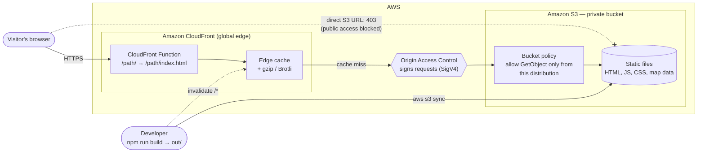

# World Clock

An animated, map-based world clock: live local times for ~160 cities on an interactive
map with a real-time day/night line, search, city pages, bookmarks and shareable
time-zone "moments".

**Live:** https://d1vns1ylrrd3l5.cloudfront.net/

It is a Next.js (App Router) **static export** hosted on a private S3 bucket behind
CloudFront. There is no server and no API — times come from the device clock and the
browser's built-in time-zone database (`Intl`).

## Contents

- [Architecture](#architecture)
- [Run locally](#run-locally)
- [Deploy to AWS](#deploy-to-aws)
- [Troubleshooting](#troubleshooting)
- [Project layout](#project-layout)
- [Implementation notes](#implementation-notes)

## Architecture



| Service / feature           | Role                                                                   |
| --------------------------- | ---------------------------------------------------------------------- |
| **Amazon S3**               | Stores the built site. Block Public Access is ON; no website hosting.  |
| **Bucket policy**           | Lets only this CloudFront distribution read objects (`s3:GetObject`).  |
| **Origin Access Control**   | CloudFront signs its requests to S3, so the bucket can stay private.   |
| **Amazon CloudFront**       | Public HTTPS endpoint, global caching, compression, HTTP → HTTPS.      |
| **CloudFront Function**     | Rewrites clean URLs (`/bookmarks/`) to the real file (`…/index.html`). |
| **Response headers policy** | Adds security headers (HSTS, CSP, …). Recommended, optional.           |
| **AWS CLI** (`deploy.sh`)   | Uploads `out/` to S3 and invalidates the CloudFront cache.             |

**Request flow:** browser → CloudFront (function rewrites the path, cache answers if it
can) → OAC-signed request → S3 → response cached at the edge. Nobody can read the bucket
directly.

## Run locally

Requires Node.js ≥ 20.9.

```bash
npm install
npm run dev          # http://localhost:3000
```

| Command            | What it does                                                  |
| ------------------ | ------------------------------------------------------------- |
| `npm run dev`      | Dev server                                                    |
| `npm run build`    | Static export into `out/`                                     |
| `npm run preview`  | Serve `out/` on :4000 with the same URL routing as CloudFront |
| `npm test`         | Unit tests (Vitest)                                           |
| `npm run test:e2e` | Playwright smoke test against `out/` (build first)            |
| `npm run verify`   | lint + typecheck + format check + unit tests + build          |

First-time e2e setup: `npx playwright install chromium`.

## Deploy to AWS

Steps 1–3 are a one-time setup in the AWS console. Step 4 is what you run for every
release.

### 1. Create the S3 bucket (private)

1. S3 → **Create bucket** (any region).
2. Keep **Block all public access: ON**.
3. Do **not** enable static website hosting.

### 2. Create the CloudFront distribution

| Setting                | Value                                                        |
| ---------------------- | ------------------------------------------------------------ |
| Origin                 | The S3 bucket (REST endpoint, not the website endpoint)      |
| Origin access          | **Origin access control** → create a new OAC (sign requests) |
| Viewer protocol policy | Redirect HTTP to HTTPS                                       |
| Cache policy           | `CachingOptimized`                                           |
| Compress objects       | Yes                                                          |
| Default root object    | `index.html`                                                 |

Then let CloudFront into the bucket: S3 → bucket → **Permissions → Bucket policy**
(CloudFront offers a "Copy policy" button after you create the OAC):

```json
{
  "Version": "2012-10-17",
  "Statement": [
    {
      "Sid": "AllowCloudFrontServicePrincipalReadOnly",
      "Effect": "Allow",
      "Principal": { "Service": "cloudfront.amazonaws.com" },
      "Action": "s3:GetObject",
      "Resource": "arn:aws:s3:::YOUR_BUCKET/*",
      "Condition": {
        "StringEquals": {
          "AWS:SourceArn": "arn:aws:cloudfront::YOUR_ACCOUNT_ID:distribution/YOUR_DISTRIBUTION_ID"
        }
      }
    }
  ]
}
```

### 3. Finish the distribution

**a. URL rewrite function (required).** Without it only `/` works; every other page
(`/bookmarks/`, `/city/karachi/`) returns 403 on refresh or direct link.

1. CloudFront → **Functions → Create function**, runtime `cloudfront-js-2.0`.
2. Paste `infra/cloudfront-function.js`, save, **Publish**.
3. Distribution → **Behaviors** → edit default → **Function associations → Viewer
   request** → select the function.

Test the function locally with `node infra/cloudfront-function.test.mjs`.

**b. Custom error pages (required).** A private bucket answers 403 for missing files, so
map both codes to the app's 404 page under **Error pages**:

| HTTP error | Response page | Response code | Error caching TTL |
| ---------- | ------------- | ------------- | ----------------- |
| 403        | `/404.html`   | 404           | 60                |
| 404        | `/404.html`   | 404           | 60                |

**c. Security headers (recommended).** Create a response headers policy and attach it to
the default behavior:

| Header                      | Value                                          |
| --------------------------- | ---------------------------------------------- |
| `Strict-Transport-Security` | `max-age=63072000; includeSubDomains; preload` |
| `X-Content-Type-Options`    | `nosniff`                                      |
| `X-Frame-Options`           | `DENY`                                         |
| `Referrer-Policy`           | `strict-origin-when-cross-origin`              |
| `Content-Security-Policy`   | see below                                      |

```
default-src 'self'; script-src 'self' 'unsafe-inline'; style-src 'self' 'unsafe-inline'; img-src 'self' data:; font-src 'self'; connect-src 'self'; object-src 'none'; base-uri 'self'; form-action 'self'; frame-ancestors 'none'; upgrade-insecure-requests
```

`'unsafe-inline'` is needed because a static export cannot use per-request nonces and
Next.js inlines its bootstrap scripts. Everything is first-party — no third-party
scripts, fonts or analytics.

### 4. Deploy a release

Needs the AWS CLI with credentials that can write to the bucket and create
invalidations. On Windows, run it from Git Bash.

```bash
export S3_BUCKET=your-bucket
export CLOUDFRONT_DISTRIBUTION_ID=E123EXAMPLE
export NEXT_PUBLIC_SITE_URL=https://d1vns1ylrrd3l5.cloudfront.net
export AWS_PROFILE=your-profile          # optional

DRY_RUN=1 ./scripts/deploy.sh            # preview the changes
./scripts/deploy.sh                      # build, upload, invalidate
```

The script:

1. Runs `npm run build` (skip with `SKIP_BUILD=1`).
2. Uploads `_next/static/*` first, cached forever (`immutable`) — file names are hashed.
3. Uploads everything else with `max-age=0, must-revalidate`, so new releases show up
   immediately.
4. Deletes files that are no longer in the build and invalidates `/*` on CloudFront.

Nothing AWS-specific is stored in the repo; all values come from environment variables.

> Uploading `out/` by hand in the S3 console also works, but the files get no
> `Cache-Control` headers. Prefer the script.

## Troubleshooting

| Symptom                                          | Cause and fix                                             |
| ------------------------------------------------ | --------------------------------------------------------- |
| `/` works, other pages return 403 `AccessDenied` | The CloudFront Function is not attached — step 3a.        |
| Every URL returns 403                            | Bucket policy missing or wrong distribution ARN — step 2. |
| Unknown URLs show an XML error                   | Custom error pages not configured — step 3b.              |
| Old version still showing after a deploy         | Wait for the invalidation to complete, then hard-refresh. |
| Share previews link to `localhost`               | `NEXT_PUBLIC_SITE_URL` was not set when building.         |

## Project layout

```
app/                 routes: /, /city/[slug], /bookmarks, /settings, not-found, sitemap, robots
components/          map/, home/, city/, clock/, search/, bookmarks/, settings/, ui/
lib/time/            pure, tested time utilities (offsets, DST, formatting, sun, terminator)
lib/store/           Zustand stores: ticker, settings, bookmarks, ui
lib/map, lib/search  label collision, fly-to interpolation, fuzzy search
data/cities.ts       city data (IANA zones only — no hardcoded offsets)
public/data/         world map TopoJSON (served locally)
scripts/             deploy.sh, preview.mjs, fix-segment-files.mjs
infra/               CloudFront Function + local test
e2e/                 Playwright smoke test
```

## Implementation notes

- **One ticker.** A single 1-second ticker (`lib/store/ticker.ts`) drives every clock. It
  pauses in hidden tabs, and components re-render only when their displayed text changes.
- **Cheap map frames.** Panning and zooming move markers imperatively; React does not
  re-render.
- **No hydration mismatches.** Time-dependent UI renders a skeleton in the static HTML and
  fills in after mount.
- **Validated input.** localStorage, URL parameters and imported JSON are validated with
  Zod (`zod/mini`) before use.
- **Bundle budget.** Initial JS for `/` is ~181 KB gzipped; the map, validators, search and
  panels load lazily.
- **Windows build quirk.** Next.js 16.4 on Windows writes prefetch files into nested
  folders; `scripts/fix-segment-files.mjs` (`postbuild`) flattens them. It does nothing on
  Linux/macOS.
- **Privacy.** No cookies, analytics or external requests. Bookmarks and settings stay in
  the browser's `localStorage`; fonts are self-hosted.
